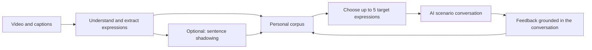
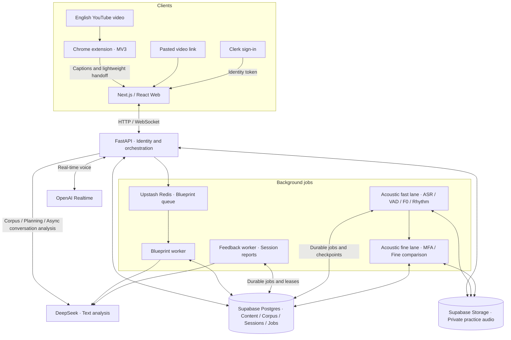

<h1 align="center">Libitu</h1>

<p align="center">
  Turn authentic English into language you can use.<br />
  An open-source AI English-practice app
</p>

<p align="center">
  <a href="README.md">中文</a> · <strong>English</strong>
</p>

<p align="center">
  <a href="design/docs/GETTING_STARTED.en.md"><strong>Get started</strong></a> ·
  <a href="#system-architecture">Architecture</a> ·
  <a href="#documentation">Documentation</a> ·
  <a href="https://github.com/kongshan33/libitu/issues">Issues</a> ·
  <a href="#contributing">Contributing</a>
</p>

<p align="center">
  <a href="LICENSE"></a>
  <a href="https://github.com/kongshan33/libitu/stargazers"></a>
  <a href="TASK.MD"></a>
</p>

---

## About Libitu

Libitu is an AI English-practice app connecting YouTube videos, a personal corpus, sentence shadowing, and scenario conversations. Save a useful expression, then bring it into your next conversation to turn input into active speaking practice.

The project code is [MIT-licensed](LICENSE), allowing self-hosting and commercial use.

> [!NOTE]
> Libitu is in development, with a paid hosted service planned. It has not launched; hosted-service pricing and features have not been announced.

## Features

- **Learn from videos**: paste a YouTube link or use the Chrome extension to explore captions, content summaries, and useful expressions.
- **Build a personal collection**: save, filter, and edit chunks, idioms, and sentence structures with their original context.
- **Practice sentence by sentence**: record and replay your voice, check the words you spoke, and explore Sound, Rhythm, and Melody feedback covering timing, pauses, rhythm, and pitch. Optionally prepare reference audio for comparison.
- **Have AI conversations**: choose expressions to practice, set a scenario and goal, and talk to AI through real-time voice or text.
- **Review your practice**: read session reports backed by quotes from your conversation, and revisit your practice history and learning activity.

Move straight from saved expressions to a conversation, or practice shadowing first. Acoustic feedback and session scores are still being evaluated; they are not calibrated pronunciation diagnostics or general English proficiency assessments.

### Learning flow



## Built with

| Layer | Technology |
| --- | --- |
| Web | Next.js 15, React 19, TypeScript |
| Browser extension | Chrome Manifest V3 |
| API and workers | FastAPI, Python |
| Identity and data | Clerk, Supabase Postgres / Storage, Upstash Redis |
| AI | DeepSeek text analysis, OpenAI Realtime voice |
| Shadowing analysis | faster-whisper, MFA, Silero VAD, Praat |
| Tooling | pnpm, Turborepo, uv |

## Getting started

The current way to explore Libitu is through a local development environment. You need Node.js 22.18+ (22.x), pnpm 10.19.0, Python 3.11–3.14, uv, and a Clerk development application for sign-in.

```bash
git clone https://github.com/kongshan33/libitu.git
cd libitu
pnpm install
cd apps/api
uv sync --extra dev --extra acoustics
```

Follow the [local development guide](design/docs/GETTING_STARTED.en.md) to configure environment variables and start the API and Web separately. Development mode uses deterministic data; real video analysis, live conversations, and persistence require additional services. Model calls use your own credentials and may incur charges.

See the [extension guide](apps/extension/README.md) for Chrome setup. Production deployment requires separate configuration and validation; a running local environment does not establish production readiness.

## System architecture

This diagram shows the implemented paths with external services configured. The `inline` development mode uses in-memory adapters and deterministic data.



- **Three processing paths**: video blueprints use the Redis queue. Shadowing analysis and session reports use durable Postgres jobs and leases; they do not share the Redis queue.
- **Separate voice and text responsibilities**: the API manages real-time conversations and finalized turns. Asynchronous DeepSeek analysis does not block the current voice reply. Corpus pronunciation uses separate OpenAI voice settings.
- **Data boundaries**: the server verifies identity for private corpus and session access. Audio analysis and recording retention have separate user controls.
- **Optional adapters**: Ark/Doubao text analysis and Gemini voice remain explicit configuration options. The diagram shows the defaults.

## Documentation

- [Local development guide](design/docs/GETTING_STARTED.en.md): environment, services, workers, and extension setup.
- [Product design](design/docs/Libitu_Design_Spec.md): learning flows and interaction contracts.
- [Project status](PROJECT.MD) and [task plan](TASK.MD): implemented capabilities and remaining work.
- [Real-time conversation implementation](design/docs/STAGE_FOUR_IMPLEMENTATION.md): voice, turn ownership, and recovery.
- [Shadowing analysis contract](design/docs/STAGE_TWO_PRACTICE_ANALYSIS.md): acoustic jobs, audio retention, and data boundaries.

The current focus is the English-video learning loop; caption availability depends on the source. Article and pasted-text reading remain planned. Independent speech-phenomena research is not integrated into the business API.

## Contributing

Use [Issues](https://github.com/kongshan33/libitu/issues) to report bugs or discuss features. Read the [development conventions](CLAUDE.MD) and agree on the scope before contributing code.

```bash
# Run at the repository root after setting up the local environment.
pnpm lint
pnpm test
pnpm build
```

## License

This project is licensed under the [MIT License](LICENSE). You may use, modify, distribute, and commercialize it while retaining the copyright and permission notices required by the license.

Third-party code, dependencies, models, and data remain subject to their respective licenses. The MIT license does not include access to third-party APIs, hosting resources, or usage credits.
