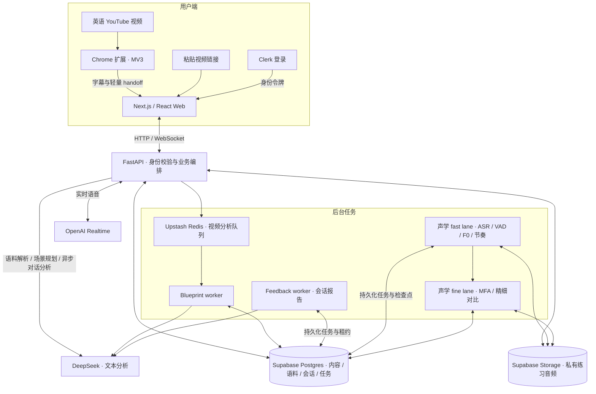

<h1 align="center">libitu.</h1>

<p align="center">
  把真实英语内容，变成你能用出来的表达。<br />
  开源的 AI 英语练习应用
</p>

<p align="center">
  <strong>中文</strong> · <a href="README.en.md">English</a>
</p>

<p align="center">
  <a href="design/docs/GETTING_STARTED.zh.md"><strong>开始使用</strong></a> ·
  <a href="#系统架构">系统架构</a> ·
  <a href="#文档">文档</a> ·
  <a href="https://github.com/kongshan33/libitu/issues">问题反馈</a> ·
  <a href="#参与贡献">参与贡献</a>
</p>

<p align="center">
  <a href="LICENSE"></a>
  <a href="https://github.com/kongshan33/libitu/stargazers"></a>
  <a href="TASK.MD"></a>
</p>

---

## 关于 Libitu

Libitu 是一个 AI 英语练习应用，将 YouTube 视频、个人语料库、逐句跟读和情景对话连接起来。收藏一个有用的表达，再把它带进下一次对话，让输入真正转化为输出。

项目代码采用 [MIT 许可证](LICENSE)，支持自行部署和商业使用。

> [!NOTE]
> Libitu 正在开发中，计划提供付费托管服务。目前尚未上线，托管服务的定价与功能范围尚未公布。

## 功能

- **视频学习**：粘贴 YouTube 链接或通过 Chrome 扩展进入，查看字幕、内容概要和表达解析。
- **个人语料库**：收藏、筛选和编辑视频中的语块、习语与句式，保留来源上下文。
- **逐句跟读**：录音、回放并检查跟读内容，查看 Sound、Rhythm、Melody 三层反馈，了解发音相关时长、停顿、节奏与音高变化；可选准备参考音频进行对比。
- **AI 情景对话**：选择想练习的表达，设置场景与目标，通过实时语音或文字与 AI 练习。
- **练习反馈**：查看带有对话原文依据的会话报告，以及个人练习记录和学习活动。

你可以从视频中收藏表达后直接开始情景对话，也可以先进行跟读练习。声学反馈和会话评分仍在验证中，不代表经过校准的发音诊断或英语能力测评。

### 学习流程


## 技术栈

| 层 | 技术 |
| --- | --- |
| Web | Next.js 15、React 19、TypeScript |
| 浏览器扩展 | Chrome Manifest V3 |
| API 与后台任务 | FastAPI、Python |
| 身份与数据 | Clerk、Supabase Postgres / Storage、Upstash Redis |
| AI | DeepSeek 文本分析、OpenAI Realtime 语音 |
| 跟读分析 | faster-whisper、MFA、Silero VAD、Praat |
| 工程工具 | pnpm、Turborepo、uv |

## 开始使用

当前可通过本地开发环境体验。需要 Node.js 22.18+（22.x）、pnpm 10.19.0、Python 3.11–3.14、uv，以及用于登录的 Clerk 开发应用。

```bash
git clone https://github.com/kongshan33/libitu.git
cd libitu
pnpm install
cd apps/api
uv sync --extra dev --extra acoustics
```

接着按[本地开发指南](design/docs/GETTING_STARTED.zh.md)配置环境变量，分别启动 API 和 Web。开发模式使用确定性数据；真实视频分析、实时对话和持久化需要额外配置服务。模型调用使用你自己的凭据并可能产生费用。

Chrome 扩展的安装与使用见[扩展说明](apps/extension/README.md)。生产部署仍需单独配置和验证，本地启动不等于上线就绪。

## 系统架构

下图描述配置外部服务后的实现路径；`inline` 开发模式使用内存适配器和确定性数据。



- **三条处理路径**：视频 Blueprint 使用 Redis 队列；跟读分析和会话报告使用 Postgres 持久化任务与租约，并非所有任务都走 Redis。
- **语音与文本分工**：API 管理实时对话和已完成的轮次；DeepSeek 异步分析不阻塞当前语音回复。语料朗读使用独立的 OpenAI 语音配置。
- **数据边界**：私有语料与会话由服务端校验身份；音频分析和历史录音保留分别受用户设置控制。
- **可选适配器**：Ark/Doubao 文本分析与 Gemini 语音适配器保留为显式配置选项，图中展示默认路径。

## 文档

- [本地开发指南](design/docs/GETTING_STARTED.zh.md)：环境、服务、后台任务与扩展安装。
- [产品设计](design/docs/Libitu_Design_Spec.md)：学习流程和交互约定。
- [当前进度](PROJECT.MD)与[任务计划](TASK.MD)：已实现能力与待完成工作。
- [实时对话实现](design/docs/STAGE_FOUR_IMPLEMENTATION.md)：语音、轮次和恢复机制。
- [跟读分析契约](design/docs/STAGE_TWO_PRACTICE_ANALYSIS.md)：声学任务、音频保留和数据边界。

当前重点是英语视频学习闭环，字幕可用性取决于来源。文章 / 粘贴文本阅读仍在规划中；独立语音现象研究尚未接入业务 API。

## 参与贡献

欢迎通过 [Issues](https://github.com/kongshan33/libitu/issues)反馈问题、讨论功能。提交代码前请阅读[开发约定](CLAUDE.MD)，并先确认改动范围。

```bash
# 完成本地环境配置后，在仓库根目录执行
pnpm lint
pnpm test
pnpm build
```

## 许可证

本项目采用 [MIT 许可证](LICENSE)。你可以使用、修改、分发和商用本项目，须保留许可证规定的版权及许可声明。

第三方代码、依赖、模型和数据仍遵循各自的许可条款。MIT 许可不包含第三方 API 服务、托管资源或调用额度。
