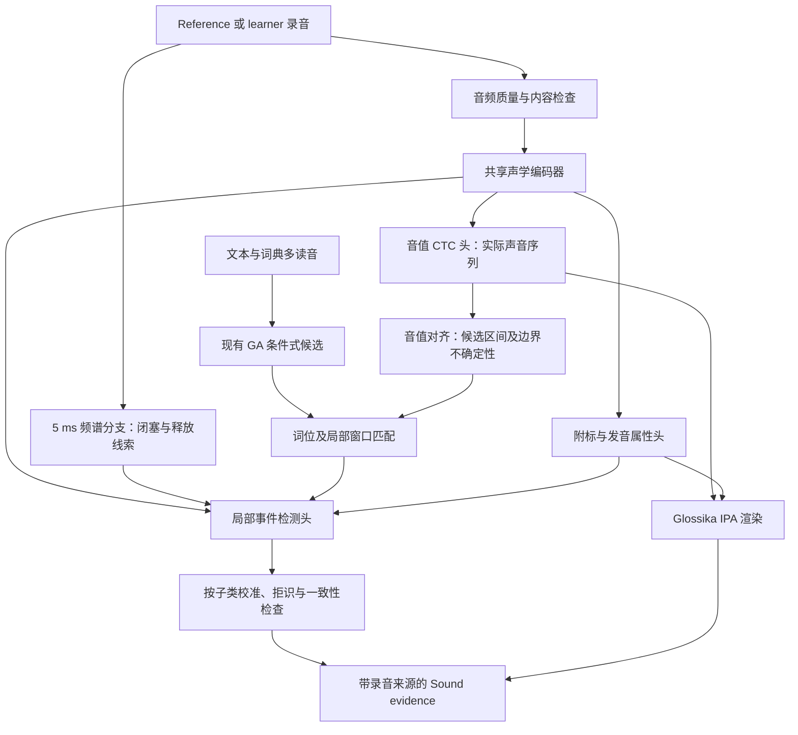

# Libitu 音素与语音现象模型：完整技术实施方案

日期：2026-11-09。状态：**待实施的模型方案，包含已验证基线和逐阶段验收标准**。本文件完成技术设计，不表示模型已经训练或上线。GA 是教学目标，不是所有录音的真实口音标签。

## 1. 目标与架构决定

目标是同时回答两个问题：

1. **录音实际发出了哪些声音？** 输出 surface phones（表层音值）、IPA、时间范围和不确定性；词典 phonemes（音位／目标读音）另存，不用词典答案覆盖录音。
2. **哪个词位发生了何种语音变化？** 在同一录音的音值、上下文和局部声学证据上，识别 Sound 的 12 类现象及子类，区分检测到、未检测到、证据不足和未支持。

默认路线：**Wav2Vec2Phoneme 编码器 + 自定义音值 CTC 头 + 附标属性头 + 局部事件头**。短促声学事件再加一条 5 ms hop 的频谱分支。以有监督训练（SFT）为主；先冻结编码器，再按验证结果解冻顶部少量层。LoRA 是可选的参数更新方式，不是替代标签的训练目标；暂不使用强化学习。

保留原始 392-token 模型作为不可变基线。当前 117-token 字符头仅作旧实验对照，不直接认定为最终生产 tokenizer。最终使用“声学单位与附标结构化输出 → Glossika 风格渲染”，保留原始 source IPA，不靠字符串外观学习全部语音学区别。



**文本只帮助定位和限定候选；不作为某现象已发生的证据。** 音值解码头以音频为输入，不以正确句子为解码答案。Reference 和 learner 各自独立推理，最后才比较；禁止把 Reference 的事件复制给 learner。

## 2. 当前证据与缺口

以下数值来自本次核对的工作树和冻结结果，指标不能跨不同测试集直接比较。

| 已有资产 | 当前事实 | 对方案的约束 |
|---|---|---|
| Glossika 短句 | 588 条索引，549 条可用训练导出，音频合计 490.546 秒，约 8.18 分钟；50 条有既有人工核对 | 足以跑通流程，不能支持 12 类的可靠泛化结论 |
| v4 词表 | 自建 117 项；兼容原头的扩展版 481 项；旧版本冻结 | 支持符号输出不等于相应声音已有足够训练实例；重音也不是全部覆盖 |
| 四编码器探针 | Wav2Vec2Phoneme 在现有小样本固定探针下领先 | 只说明当前 checkpoint、线性头、数据与预算下更适合；不证明它在事件检测上必然最好 |
| 原模型继承头 / 新头 | 旧八条外部回归上，扩展训练未稳定超过原模型 | 不直接继续扩大同一种训练；需要专业多说话者数据与任务分解 |
| v7 匹配对照 | 362/97/90 源文件分组；两组各 3 seeds × 3,160 updates；兼容 CER 31.13% / 30.89% | 26 处变化均为等价记法，不能归因为修复声学标签噪声 |
| 新五条开发听辨 | 3 种句子、2 个源说话者；标注与三处用户确认已冻结 | 继续用于诊断，不能回流训练或充当新盲测 |
| 产品 Sound | `sound-rules-v3` 提供 12 类词典／文本候选 | 当前不是 12 类音频检测器 |
| 声学接口 | `SoundCheck.realization` 当前固定 `not_evaluated`；离线 benchmark 的事件枚举还是旧分类 | 新证据需要独立版本协议和适配器，不能覆盖老字段含义 |

证据：[四底座探针](../benchmarks/sound-encoder-eval-20261109/IPA-PROBE-V3.md)、[v4 词表](../benchmarks/sound-glossika-20261108/vocab-v4/README.md)、[新头实验](../benchmarks/sound-glossika-20261108/IPA-FRESH-V4.md)、[v6 标签接收](../benchmarks/sound-glossika-20261108/IPA-REVIEW-V6.md)、[v7 对照](../benchmarks/sound-glossika-20261108/IPA-PAIRED-LABELS-V7.md)。

旧实验均继续保留。现在的专业教材数据不能因“专业发音”就升级为“所有附标、边界和事件均有逐录音金标”。

## 3. 模型选择与可替换范围

| 组件 | 主选 | 对照 / 后备 | 选择条件 |
|---|---|---|---|
| 初始声学编码器 | 固定 revision 的 `facebook/wav2vec2-lv-60-espeak-cv-ft` | 已缓存 WavLM Base+、WavLM Large、HuBERT Large | 当前 IPA 迁移基线最好，工程与缓存已有 |
| 表层音值头 | 新的结构化音值 CTC 头 | v4 字符 CTC、原 392-token 头 | 在相同专业数据和相同解码口径下选型 |
| 事件表征 | 同一编码器的中层／顶层加权特征 | WavLM Base+ / Large 的相同事件探针 | 事件选择依据独立事件验证集，不沿用 IPA 排名 |
| 独立 IPA 对照 | ZIPA CR-small / CR-large | Allophant | 供候选、分歧分析和弱标签；不作为金标 |
| 属性建模参考 | 自建 masked 属性头 | Allophant 属性输出 | 使用真实部分标签；未知属性不当负例 |
| 更大后备底座 | 暂不增加默认训练负担 | `facebook/w2v-bert-2.0` | 仅当同样数据预算仍受限且有算力时纳入同协议测试 |

Wav2Vec2Phoneme 官方说明其在 Common Voice 上做过多语音素任务微调；Allophant 以 XLS-R-300M 为基础，提供音素和发音属性输出。因此既有音素模型可以接并行分类头，并不存在“已经用于音素识别，就不能做事件检测”的结构限制。[Wav2Vec2Phoneme 模型卡](https://huggingface.co/facebook/wav2vec2-lv-60-espeak-cv-ft)、[Allophant 模型卡](https://huggingface.co/kgnlp/allophant)、[多任务属性方法论文](https://www.isca-archive.org/interspeech_2023/glocker23_interspeech.html)。

ZIPA 官方有 CTC 和 Transducer 系列，并有带／不带附标版本。锁定具体模型、token 文件及权重哈希，不能仅写“ZIPA”；符号集合大不构成事件准确率证据。[ZIPA 官方仓库](https://github.com/lingjzhu/zipa)。W2v-BERT 2.0 作为可选 Conformer 编码器，不在本地已有四底座比较结论之内。[官方模型卡](https://huggingface.co/facebook/w2v-bert-2.0)。

## 4. 数据路线：不再依赖用户新增标注

### 4.1 专业现成标注优先

| 数据来源 | 使用方式 | 能提供什么 | 不可直接当作什么 |
|---|---|---|---|
| 已有 Glossika | 保留原文；扩展词汇／专题章节；每段保留教材页码和切分来源 | 教学记法、音值组合、相关最小对比上下文 | 全部 12 类逐录音事件金标；未知说话者身份 |
| TIMIT | 导入官方训练／测试结构与 `.PHN/.WRD/.TXT`；保留原完整音码 | 人工核验的音值与时间边界，约 5 小时、630 名说话者、多种美音方言 | 全部 GA 口语现象；闭塞标签不等于无可闻释放事件 |
| Buckeye | 导入 `.words/.phones/.log`，按源说话者切分 | 40 名说话者的自然对话，人工修订的词／音值边界和部分语音细节 | 每个未写出的附标都不存在；所有事件定义已与本产品一致 |
| L2-ARCTIC | 只把人工标注子集当强监督；其余强制对齐部分降级 | 非母语说话者、修订边界和替换／删除／增加标签 | 全语料都有人工作证；native GA 现象金标 |
| ZIPA / Allophant 自动输出 | 多模型一致性与分歧队列；有来源的弱监督 | 降低筛选成本、暴露缺覆盖 | 人工修订标签或封存测试答案 |

TIMIT 的官方介绍明确区分人工核验转写及官方 train/test；Buckeye 的流程是先自动对齐，再由受过语音学训练的人员修订。L2-ARCTIC 明确只有约每说话者 150 条为人工修订子集，其余转写包含强制对齐生成部分。导入器必须保留这些差别。[TIMIT](https://catalog.ldc.upenn.edu/LDC93S1)、[Buckeye 数据说明](https://buckeyecorpus.osu.edu/)、[Buckeye 标注流程](https://buckeyecorpus.osu.edu/php/corpusTran.php)、[L2-ARCTIC](https://psi.engr.tamu.edu/l2-arctic-corpus/)。

当前工作区已核实有 Glossika；上述新增语料**尚未导入**。实施时先登记可获得的数据版本及获取状态，不能把目录占位当已下载、把预期数量当实际可用量。不在本方案中启动采购、对外联系或提交用户身份资料。

### 4.2 缺失标签如何补齐

按证据强度分四层：

- `source_phone_gold`：专业语料明确核验的音值／边界；对应属性才进入强监督。
- `derived_event`：在已核验表层音值与词位对应上导出的事件，保留推导规则版本；仍可能有词典变体歧义。
- `book_supervision`：教材 IPA 与录音关联，附带关联置信度、未知字段。
- `pseudo_label`：模型建议；只能进入低权重训练分支，不能进入正式测试。

用户无需再次标注。优先消化专业语料已有标签；对真正缺少的事件定义，路径是组织具备语音学能力的独立标注／复核人员，或使用已有满足定义的专家事件数据。双人抽样复核分歧用于修订手册。**如果既没有现成标签、也不引入任何人工专家，不能承诺可靠训练并验证全部 12 类；该子类保持研究状态。** 模型投票不能解除这个限制。

规划规模而非已取得事实：先争取 5–20 小时录音级音值标注、多说话者且兼有朗读／对话；事件试验每个有限子类先统计至少数百个正例、覆盖十余名说话者，并配上下文相同的负例。上线所需规模由学习曲线和置信区间决定，不设“到某个小时数就一定足够”的结论。单类样本来自一位说话者时，再多切片也不构成说话者泛化证据。

### 4.3 数据转换与质检

导入流水线：原始音频与文件哈希 → 16 kHz 单声道副本 → 原时间坐标到副本坐标的映射 → 原始音标解析 → 结构化音值与属性 → 标签来源／覆盖掩码 → 分组切分 → tokenizer 预检 →冻结 manifest。

- 保存原采样率、原声道、裁切 sample 范围；音量归一化不得改变相对时长，不做默认强降噪。
- 文本关联失败、重叠说话、截断、明显削波、过长静音、时间越界和无穷 CTC loss 单独排队，不静默删除后只报好结果。
- 字符覆盖、音值出现频次、每个附标的正／负／未知数分别统计。`vocab_present`、`seen_in_training`、`validated_for_output` 是三个字段。
- 所有标签更新版本化；教材原文、人的填写、确认修订、模型输出四层独立保存。
- 同一个标签没有附标，只有在该语料标注规范明确“完整标注此属性”时，才可作为这个附标的负例。

### 4.4 训练／验证／测试划分

1. 先按真实 speaker/session/source recording 分组；重复 PCM 和近重复音频合并，句子模板与书籍章组进一步检测。未知说话者的 Glossika 只能宣称源录音分组。
2. 遵循专业语料官方测试集，不把官方测试拿来训练；训练部分再按说话者切验证集。TIMIT 类共享朗读句另做句型隔离诊断，不能声称说话者隔离等于文本隔离。
3. 自定义数据可用 80/10/10 作为目标比例，分组完整性优先，不强凑句数比例。
4. 训练归一化统计、阈值、温度校准、层选择全部只用 train/dev。test 在最终 release 后评一次；曝光后登记为回归集。
5. 同时有“同域专业音值测试”“未见说话者自然对话测试”“学习者测试”三条测试轴，分别报告，禁止混成一个好看的平均数。
6. 保留旧 v7 362/97/90、旧八条及新五条作为已曝光回归材料；不更名为新独立测试。

## 5. 标签表示与 Glossika 渲染

### 5.1 不再让每个 Unicode 字符承担同一语音学角色

新建版本 `phonetic-units-v1`，三层分开：

- **base phone**：实际音值，例如 `t, d, ɾ, ʔ, ɹ, ɫ, m, n, ŋ, ə, ɪ`，塞擦音为明确的复合单位；不能为了标准 39-phone 分数提前把所有音值差异合并。
- **attributes**：成音节、鼻化、清化、无可闻释放、送气等；每个属性有 observed/unknown 掩码及附着对象。
- **prosody / boundaries**：词汇重音、词界、短语边界；词间连读记号不是复合音值的结合弧。

CTC 的 `<blank>` 与缺音事件不同，不能把 blank、没有输出、强制对齐零时长当成 elision。重音缺乏监督时输出未知，不由词典重音直接伪装为实际韵律识别。

### 5.2 兼容现有资料

- 原始 IPA 字节不变；用于比较的 Unicode NFC/NFD 规则单独版本化。
- `ṇ` 的成音节含义已有用户确认；解析为 `n + syllabic`，Glossika 显示仍为 `ṇ`。其他源符号依据源规范建立显式表，不做字形猜测。
- `ʧ/t͡ʃ` 等已确认等价写法可在内部映射为同一单位；`d̪/ð`、`r/ɹ`、`eʲ/eɪ`、`ʴ/ɚ` 不全局无条件合并。
- 用户确认 `dræŋk` 的 r 是 ɹ，仅属于相应记录的修订，不由此把全部 r 都改成 ɹ。
- `eɪ` 与 `eːʲ` 若涉及真实长短／音质区别，保留结构化差别；Glossika 风格不是把所有双元音机械换成附标。
- TIMIT 等源码采用逐码映射审计。闭塞与释放可分开标注；拼成音值时保留原子阶段，不因简化 PER 丢失事件训练所需信息。
- `surface_ipa_observed` 与 `canonical_pronunciation` 分开返回；不能用后者修补前者的低置信度位置。

渲染器是确定性代码，有 schema、字符附着约束和往返测试；不使用 LLM 自由补写 IPA。最终 vocabulary 的大小由导入语料与明确的 GA 范围生成并冻结，不能把当前 117 个字符硬说成完整表层音值集合。

## 6. 神经网络实现

### 6.1 编码器和时间分辨率

当前固定 Wav2Vec2Phoneme 为 24 层、hidden size 1024。实机配置卷积 stride `[5,2,2,2,2,2,2]`，16 kHz 下输出步距 320 samples，即 20 ms；kernel `[10,3,3,3,3,2,2]` 推得前端局部感受野 400 samples，即 25 ms。Transformer 使用更长上下文，**20 ms 帧步距不是 20 ms 的边界准确率承诺**。[本地注册表](../../apps/api/scripts/sound_pilot/encoder_models.py)；配置字段含义参考 [Transformers Wav2Vec2 文档](https://huggingface.co/docs/transformers/model_doc/wav2vec2)。

音值分支起点用顶层；事件分支候选取第 6/12/18/24 层，学习 softmax 层权重或在开发集选择固定层。不同任务可取不同层，不能用原 IPA 最优层替事件任务做选择。

### 6.2 音值 CTC 头

输入 `H ∈ R[B,T,1024]`：

```text
LayerNorm(1024)
→ Linear(1024, 512) + GELU + Dropout(0.1)
→ Linear(512, V_surface + blank)
→ log_softmax → CTC
```

同时保留线性头作为严格对照，不能一边换标签一边换层数、预算和解码器再归因为数据改善。旧 392-token 头可以冻结为诊断旁路；需要继承新头某些权重时，只有声学定义和 token 完全一致才允许复制行，复合单位不得简单平均旧字符行冒充可靠初始化。

自由音值解码默认 greedy；小 beam 作为独立试验，报告原始输出和 constrained 输出。只限制非法附标附着，不使用目标句子强制把结果改成正确读音。

### 6.2.1 不同语料宽窄口径的训练路由

这是避免重复当前迁移问题的必要实现：**不能把所有源标签转成一个字符串后直接混训**。

- 明确区分了表层音值的样本，进入主 surface-phone CTC 头；例如源规范明确支持 tap 区分，才把实际 tap 映射到 ɾ。
- 只给宽式 /t/、未区分 tap 的样本，不把它作为“不是 ɾ”的监督。初版给该 source profile 单独的辅助 broad CTC 头，更新共享编码器，但不产生细粒度属性负例。
- Glossika 暂用独立 literal 辅助头保留教材监督；仅映射经过人工规范审计的表层单位进入主头。源码中无法唯一解释的附标保存为原文，不猜属性。
- 独立辅助头仅在训练使用；生产以主 surface 头和已过 gate 的属性头输出。不同 source profile 的分数分开，防止某一种字母写法主导共享表征。
- 多路径 graph-CTC 可作为后续替代，用于合法的表层变体集合；第一版不临时实现未经验证的概率合并。尤其不能简单把多个 token 的帧概率相加，就声称解决了 CTC 折叠与序列长度的差别。

这样，共享声学表征能利用更多专业数据，同时不会被粗标注反复教成“没有这些窄式细节”。训练日志按 source profile 分项记录梯度与 loss。

### 6.3 属性头

对音值对应的软对齐／边界区间池化后，使用 `MLP(1024→256→K)`：

- 独立可共存属性用 sigmoid：鼻化、成音节、部分清化等。
- 互斥状态用 softmax：明确枚举的口腔释放／鼻腔释放／舌侧释放／无可闻释放／其他；只在有相应监督时启用。
- 每项属性独立 `label_mask`。未知项不参与 loss，不转换成 0。
- 训练时报告 gold-boundary 和 predicted-boundary 两种条件；不得只在真值窗口上取得漂亮分数，部署却全靠预测窗口。
- 初期强制对齐可用于池化辅助训练；后续改成预测边界加 jitter，并保留低边界质量的拒识。

### 6.4 局部事件头与精细声学分支

候选局部窗口默认中心两侧各 250 ms，长窗口扩展到覆盖相关词或两个词；边界需带上下文，避免裁掉过渡线索。上下文范围作为可调参数由开发集确定。

主支：局部 SSL 特征 `→ Linear(1024,256) → 2 层轻量时序模块 → attention/mean pooling`。

精细支：16 kHz waveform `→ 80-bin log-mel（25 ms window / 5 ms hop）→ 3 层时序卷积`；附加能量、谱变化、周期性等可审计特征。以实测验证 25 ms 窗是否足够；闭塞／释放需要更细时再对照 10 ms window，不把 hop 小等同于真实可辨性高。

融合：`[SSL pool, fine pool, predicted-phone posterior features, context embedding, quality] → 256 → kind-specific logits`。做“仅音频”“仅上下文”“音频+上下文”消融；文本条件可用，但事件头不能仅凭候选模式输出 detected。

每类独立输出，允许同一位置同时出现不同现象。例如声门加强和无可闻释放可以共存；替代与保留口腔塞音的加强必须有各自条件。多个类别不做一个 12-way softmax。

## 7. 十二类现象的具体实现与标签需求

下表是完整覆盖设计。实际开启由每个子类的数据／评测门槛决定，而不是一次性把全部分类器置为可用。

| kind / 子类 | 观测单位与模型目标 | 正负例与必需证据 | 主要混淆及拒识条件 |
|---|---|---|---|
| `flap/tap` | 目标 /t,d/ 局部表层实现：tap、oral stop、glottal、other | 专业表层音标加上下文；ɾ 正例、同条件未闪音负例；短暂闭塞与过渡声学辅助 | d、r、口腔塞音和偶发噪声；单帧 IPA ɾ 不能独立定案 |
| `coalescence/yod` | /t,d,s,z/ + /j/ 对应局部表层序列／类别 | 有融合与未融合的同环境实例，词位与词典多读音对应 | 原本就是 tʃ/dʒ 的词不是融合事件；跨词定位不可靠则拒识 |
| `assimilation/place,manner` | 先做 /n/→[m]/[ŋ]；输出 underlying n + surface place | 核验表层鼻音和词位；同一后接环境中的 n 保留负例 | 字面 /m/ 不是 n 同化；中间部位或连续协同发音可 uncertain；方式同化另建标签 |
| `glottal/replacement,reinforcement` | q/ʔ 类局部音值、口腔闭塞是否保留、喉化区间 | 声门动作相关专业标签及足够边界上下文 | creaky voice、VAD gap、低 F0 都不等于声门塞音；两子类证据不全只报 glottal cue/unknown |
| `unreleased/stop_cluster` | 闭塞存在且未观察到口腔释放；释放状态分类 | 明确标注释放状态的样本；有爆破、鼻腔／舌侧释放作难负例 | 爆破被下一个音掩盖、降噪抹去、闭塞段缺失；仅“没检测到 burst”不能判正 |
| `syllabic/n,l,m` | 音值承担音节核的局部实现 | n̩/l̩/m̩ 或源规范等价标签，ə+C 与非成音节 C 作负例 | 词典拼写、短元音漏检；不能只检测“没有 ə” |
| `voicing/voicing,devoicing` | 目标辅音中的周期性及部分／完整清化状态 | 明确声学标签、有效窗口；连续属性与阈值分类并报 | 无 F0 不等于清音；鼻音、气声、frication 周期性估计错误；tap 不重复归类 |
| `weak_form/function_word,vowel_reduction` | 同词强／弱实现 + 实际元音音质及上下文 | 核验实际弱式、对比重读强式；语料必须覆盖重点强调条件 | 短时长不等于弱读；所有 ə 不都算功能词弱读；重音未知时不给强断言 |
| `reduced_form/contraction,casual` | 词组对应的表层读法和词汇／语法条件 | 完整语音与词组、缩约/未缩约对照；常规 contraction 与 casual 分开 | gonna 等语法歧义；文本写成缩写仅为词汇信息，不证明录音实现 |
| `elision/td_drop,h_drop,other` | 字典候选中的目标段是否真实缺失 | 带可接受变体的局部 phonetic lattice，核验缺音与保留对照 | CTC blank、对齐挤压、无爆破、声门替代不等于省音；不确定词汇读法不判省音 |
| `linking/cv,glide,same_consonant` | 边界连续实现、glide 过渡、同辅音连接分开建模 | 每个子类需操作性标签；音值过渡与边界证据 | 无停顿不是充分条件，C–V 重音节化常无唯一声学判据；不能给所有连续语流统一 detected |
| `vowel_length/before_voiceless,before_voiced` | 相同元音在受控清浊词尾条件下的相对时长／残差 | 词尾类别、重音、语速、短语位置、元音身份和可靠边界；匹配条件的成对或分层数据 | 不设固定毫秒阈值；不能从词尾文本直接判断实际长度；用户 UI 保持相对长短提示 |

首批限定三类为 `flap/tap`、`coalescence/yod` 的 /t,d/+j、`assimilation/place` 的 /n/→m/ŋ。并非把产品缩成三类，而是这三类先建立检测—证据—评测全链路，其余按上表补齐。

音标序列可以提供“观测到 [m]”的标签，但“发生 n→m 同化”还需要底层词位／读音对照。TIMIT/Buckeye 等的实际音码必须在导入手册中逐码验证，不能因为某个代码名称像本产品类名就自动生成正例。

## 8. 边界、时长与证据定位

采用两条相互校验的路径：

- **词位定位**：既有 ASR 内容检查 → 多读音词典／MFA 词边界；只用于候选定位，不视为实际发音真值。
- **实际音值定位**：自由 CTC 输出 → 对输出本身做 CTC posterior alignment → 结合局部边界模型；不能对字典完整音串强制对齐后用“音长为 0”宣布删除。

词位匹配初版用带插入／删除／多读音分支的动态规划，将**自由识别表层序列**与词典候选序列匹配；成本结合局部声学后验和显式可接受映射表。保留 top-k 路径及最佳/次佳 margin。若 top-k 对同一词位的事件解释不一致，则拒识；不能只取最符合文本的路径。词典规则的先验与声学似然分别存档，便于发现“只靠上下文猜对”。

事件候选保留 `window_start/end`、`event_start/end`、`boundary_uncertainty_ms`、`alignment_source`。没有可靠事件边界时，仅给词位和可听上下文窗口；不显示虚构精确到毫秒的音素切片。

建议起步边界 loss 使用有掩码的帧级 onset/offset BCE；相邻帧软目标缓解人工边界差异。测试分别报告边界绝对误差和指定容差的事件匹配率。CTC 帧峰、插值到 5 ms、MFA 给出的区间都不自动成为精确边界。

Vowel length 内部可拟合 `log(duration) = vowel + stress + rate + phrase_position + speaker/random_effect + coda_voicing + residual`，或做条件匹配的 pairwise ranking。新说话者使用 population prior / 少量归一化，不要求其训练期 speaker embedding。产品仍按已确认规范展示“在相近条件下较短／较长”，不恢复绝对毫秒打分面板。

## 9. 训练目标、批次与阶段

### 9.1 多任务 loss

```text
L = λphone · L_CTC(surface_phone)
  + λattr  · masked_attribute_loss
  + λevent · masked_event_loss
  + λbound · masked_boundary_loss
  + λretain· L_KL(old_model || current_legacy_head)
```

- 每项按其有效标签数归一化；一批没有该项标签时跳过该 loss，不除以零、不制造全负标签。
- 仅当旧／新旁路 token 定义和帧坐标一致时计算 KL；温度、权重写入配置。不同 tokenizer 的 logits 不能直接 KL。保留旧原始头做兼容旁路，教师在独立副本冻结。
- 旧模型的错误不能反过来覆盖人工标签；KL 只用于保留约束，必须做无 KL 对照。
- 初始尝试 λphone=1、λattr=0.2、λevent=1、λbound=0.1、λretain=0.1，均为**待开发集验证的起始值**，不是已验证最优配置。分阶段训练时未启用任务权重为 0。
- 类别加权／focal loss 作为不平衡对照；采样权重不能用测试集估计。未知状态用 mask，低质量不能当 absent。

### 9.2 批次策略

按总音频秒数分桶，例如每 GPU microbatch 20–40 秒、梯度累积到 120–240 秒，作为初始显存试配范围。不同模型／对照使用相同 sample schedule；同时报告更新次数、看过的音频秒数和 token 数，避免“同 epochs”掩盖预算差异。

多域批次初始按“专业朗读／专业自然对话／学习者已核验／Glossika”约 35/35/20/10 抽样；缺某类时重配并记录，不伪造空域。比例为工程起点，要通过学习曲线与跨域开发集选择。Glossika 不再成为唯一监督分布。

### 9.3 分阶段执行

| 阶段 | 更新参数 | 任务与目的 | 固定对照 |
|---|---|---|---|
| R0 | 无 | 新语料与现有原模型、ZIPA、Allophant 同口径基线 | 同一音频、映射与自由解码 |
| R1 | 音值头 | 冻结编码器，线性 vs 小 MLP；验证 tokenizer、样本量、记法 | 同一数据、batch schedule、steps、seed |
| R2 | 音值头 + 顶部 4 层 | head LR 1e-4、encoder LR 1e-5 起试；下部与卷积前端冻结 | R1；有／无混合域 replay 与保留 loss 分开实验 |
| R3 | 属性／事件头 | 编码器先冻结；真实标签窗口训练，再用预测窗口 | 每类仅音频／仅文本条件／融合；gold vs predicted window |
| R4 | 顶部少量层 + 全部任务头 | 小学习率联合微调，监控音值回退与事件提升 | 单任务 vs 多任务；禁止用事件收益掩盖 IPA 退化 |
| R5 | 视需求 | LoRA / 蒸馏 / ONNX 量化与延迟优化 | 相同开发、封存测试和状态拒识策略 |

训练首选 PyTorch SFT + CTC/分类损失；AdamW、grad clip 1、固定种子。GPU bf16/混合精度需确认 CTC 在安全 dtype 执行和梯度有限；默认 `zero_infinity=False` 暴露异常，不能以设为 True 掩盖对齐失败。轻量时间／频率遮挡仅用于不破坏事件的窗口；不默认对 vowel length、闭塞类使用速度扰动或大块时间遮挡。

R2 可在 [1e-5, 5e-6] encoder LR 的小范围做预算预注册对照，不在同一八条已曝光录音上反复试到好看。若只剩 8 分钟 Glossika，继续留在 R1/数据诊断，不据此全面解冻。

### 9.4 首个可复现实验配置模板

以下是拟新增配置的起始值，数据目录和 bundle 名称必须在 D1/D2 完成后替换为真实冻结版本；不是现在就会自动启动训练的配置。

```yaml
experiment: ga_surface_phone_r1
seeds: [20261109, 20261110, 20261111]
encoder: wav2vec2-phoneme  # revision/hash 来自现有注册表
freeze_encoder: true
head: surface_ctc_mlp
source_profile_heads: true
surface_tokenizer: phonetic-units-v1
renderer: glossika-renderer-v1
optimizer: adamw
lr_head: 0.0001
lr_encoder: 0.00001       # R1 不生效，R2 才解冻指定层
weight_decay: 0.01
grad_clip: 1.0
max_updates: 10000       # 各对照同上限，并核验同批次音频秒数
warmup_updates: 500
scheduler: cosine
microbatch_audio_seconds: 30
effective_batch_audio_seconds: 180
eval_every_updates: 250
selection: dev_surface_per_with_cross_domain_regression_gate
patience_evaluations: 8
ctc_zero_infinity: false
checkpoint: [best_dev, final]
test_access: after_release_only
```

科学对照为保持预算可比，可都跑完整上限并事后取验证选择；部署训练可启用实际 early stop，但必须报告实际更新次数。大规模实验前先跑 100-step smoke，验证梯度、标签、loss 与显存，不把 smoke 指标当准确率。网络结构消融固定训练计划；partial-unfreeze / LoRA 试验另立 config，不能与本组混称“只改了一个头”。

### 9.5 LoRA 与强化学习的边界

LoRA 可插入 Transformer attention 的 q/v 投影，初始 rank 8/16、alpha 16/32，先核验当前 checkpoint 模块名和优化器实际 trainable 参数。与顶部解冻比较参数量、显存、吞吐和同协议分数；事件毫秒级信息不足不一定能靠 LoRA 修复。

本阶段不用 RL：尚无稳定自动奖励或足量可靠事件反馈，基于当前模型打分再优化容易强化相同错误。后续即使做偏好学习，也不能替代 IPA 与事件的可验证监督。

## 10. 首批三类如何自动构造训练样本

下面是**拟实现**的标签导出规则，而不是已经跑通的脚本。

1. 从专业 phone label 导入实际表层序列，保存源码及规范覆盖。
2. 由词文本＋多读音词典构造底层 pronunciation lattice；对到真实表层。若多个读音会改变事件判定，则 mask 该标签。
3. `/t,d/` 对应实际 tap，且处在已核对词位 → tap 正例；同条件 actual oral stop/glottal 为对应负例／竞争实现。别把 /r/ 的 tap 当 /t,d/ 闪音。
4. `/t,d/ + j` 对应 fused affricate 且语料明确覆盖该区别 → coalescence 候选正例；若源转写没有区分 fused 与快速相邻序列，标 unknown，不强行派生。
5. underlying /n/ 在 labial/velar 上下文对应核验 [m]/[ŋ] → place-assimilation 派生正例；本来词典就是 m/ŋ 的位置排除；同环境 n 保留为负例。
6. 每条派生事件保存 `derivation_rule_id`、词典版本、源音值区间、歧义原因。专业 phonetic gold 与 derived event 分开，不能继承“gold”称号。
7. 对可自动推导的类别先建立研究模型。正式事件测试仍需要该定义下的专家复核；这项由现有合格事件语料或专业标注流程承担，不再把用户列为必需标注者。

## 11. 完整评测协议与上线门槛

### 11.1 音素／音值层

至少同时报告：

- canonical phoneme PER（显式映射的单独任务）、surface-phone PER（保留真实音值差异）、完整 IPA 字符误差。
- 附标按**相同基础音且对齐成功**的单元计算 precision/recall/F1；未知附标不计负例；孤立附标和非法结合另报率。
- 词位/事件时间边界误差、插入／删除／替换分布、低支持音值的样本量。
- 每说话者、语料、母语背景、噪声、句长和设备切片；宏平均与微平均同时给出。
- 原模型、新模型、旧公开比较分别同集合重算。错误率可能超过 100%，不使用 `1−PER` 宣称准确率。

### 11.2 事件层

每个 kind/subtype 单独评价，不只报总体 accuracy：

- 在**相同候选条件**内比较 positive/negative/unknown，报告 precision、recall、PR-AUC、F1、每分钟假阳性、拒识率及可判覆盖率。
- `coverage` 的分母是可用测试目标；拒识不是正确负例。只让模型拒掉全部困难样本不得获得上线通过。
- gold-window 检测性能与端到端“候选召回 × 定位 × 分类”分开报告；要测文本候选遗漏的真实事件，否则整个系统 recall 被高估。
- 匹配规则预注册：同一录音同一词位/边界、相同子类，局部 interval IoU 或边界容差满足其一；短事件使用边界容差而非不稳定的 IoU 独断。
- 阈值与温度只在 dev calibration 子集选定；bootstrap 按说话者／session 分组，不能按高度相关的帧当独立样本。

### 11.3 建议的工程晋级线（待正式冻结，不是已达成成绩）

| 层级 | 建议 gate |
|---|---|
| 数据 | manifest/音频/标签哈希全通过；跨集合 speaker/session 无泄漏；不具备该字段时明确降级，不通过跨说话者 gate |
| IPA | 目标域 surface PER 相对基线至少下降 10%，配对说话者级区间支持改善；其他关键域的绝对回退不超过 1 个百分点，或明确分域路由 |
| 单个事件子类 | 端到端可判目标 precision 点估计≥0.90，95% 下界≥0.85；recall≥0.70；可判覆盖率≥0.50；独立正／负样本和说话者数足够估计区间 |
| 边界 | 有标注子集先以 median error≤20 ms、P95≤60 ms 作研发目标；不达标就只给词级窗口，不伪精确 |
| 校准 | 可靠性图与分桶误差通过审查；低质量/OOD样本的置信度下降，拒识路径可验证 |
| 鲁棒性 | 音频丢失、错句、截断、重叠、静音、低 SNR、非 GA 变体不会输出高置信度“错音” |
| 产品 | 每个显示的 detected 必须能追溯到录音、模型、区间、候选与版本；optional GA 变体缺失不作扣分 |

这些阈值要在上线试验前由项目冻结；不能事后修改门槛来接受某次结果。所有 12 类都在范围内，但一个子类 gate 未过时它的音频检测状态必须保持 unsupported/insufficient_evidence。

## 12. 推理流程与拒识

```text
normalize_audio → quality_gate → audio_phone_decode
→ word/candidate association → interval proposal
→ supported subtype heads → calibration
→ contradictions / OOD gate → evidence object
```

- 不可靠句子内容：可返回独立音值草稿，但不能挂错词位；Sound 位置信息显示 unavailable。
- 未识别到事件且窗口可用、检测器支持、正负置信度校准通过，才允许 `not_detected`。
- 模型没有训练过该子类 → `unsupported`；目标环境不存在 → `not_applicable`；音质／对齐／分布不可信 → `insufficient_evidence`。
- 词典候选继续是 `candidate`，与音频 realization 分开。不能把 candidate confidence 传给检测结果 confidence。
- 事件冲突由可解释状态表处理：例如同一 /t/ 的 replacement 与明确保留 /t/ 互斥，但不同位置可各自成立。
- 不把 confidence 当统计上正确率；只显示校准过且说明类别／域的值。没有校准的数据域最多给研究输出。
- 对训练分布外的儿童、极端嗓音、低码率录音，先报告 unknown；不能只靠高 softmax 自动判断在分布内。

## 13. API 与项目接入

### 13.1 复用与新增的代码边界

现有入口 `POST/GET /api/practice/attempts/{attempt_id}/analysis`、录音上传、取消／删除、worker lease/fenced writes 均保留。音值／事件计算走后台 worker，API 进程不加载大型模型。

| 路径 | 动作（待实现） |
|---|---|
| `apps/api/app/schemas/sound.py` | 保留文本候选；新增独立 `sound_evidence.py` 定义版本化音频证据 |
| `apps/api/app/schemas/practice_analysis.py` | `ProsodyResult` 增加可选 `sound_acoustics`；旧 `SoundCheck` 原样保留 |
| `apps/api/app/services/acoustics/` | 新增 `phone_inference.py`、`sound_event_inference.py`、`sound_alignment.py`、`sound_calibration.py`、`sound_registry.py` |
| `apps/api/app/workers/practice_analysis_worker.py` | 复用 fast/fine/checkpoint/lease；新增可重试的音值和事件阶段；失去租约或删除后禁止写回 |
| `apps/api/app/services/sound_service.py` | 候选规则保持；提供稳定 candidate ID 与词位，禁止让它承担实际音频判定 |
| `packages/types/src/stage-two.ts` | 添加同版本 evidence 类型、unsupported原因；不把 unknown转成 false |
| `apps/web/features/stage-two/sound/` 与 comparison 适配器 | 分别消费 Reference/learner evidence、候选和状态；维持现有 12 类与筛选行为 |
| `apps/api/scripts/sound_pilot/` | 保留冻结旧实验；新数据/训练脚本放新版本路径，不覆盖缓存和报告 |
| `apps/api/benchmarks/acoustics/` | 新版事件 schema；旧 `flap_t/drop_d/linking_gap` 显式适配，不与 12 类混算 |

### 13.2 拟议结果示例

下面是**接口示意数据，不是实际检测结果**。

```json
{
  "version": "sound-acoustics-v1",
  "voice": "learner",
  "audio_sha256": "<sha256>",
  "time_basis": "sentence_seconds",
  "model_bundle": "ga-surface-events-v1",
  "tokenizer_version": "phonetic-units-v1",
  "phones": [{
    "id": "p7", "base": "ɾ", "surface_ipa": "ɾ",
    "start_sec": 0.72, "end_sec": 0.76,
    "boundary_uncertainty_ms": 25,
    "attributes": {}, "status": "estimated"
  }],
  "events": [{
    "candidate_id": "<stable-candidate-id>",
    "kind": "flap", "subtype": "tap",
    "token_start": 2, "token_end": 3,
    "status": "detected", "confidence": 0.94,
    "phone_ids": ["p7"],
    "window_start_sec": 0.47, "window_end_sec": 1.01,
    "evidence_source": "acoustic_model",
    "detector_version": "tap-v1", "calibration_version": "tap-ga-dev-v1"
  }]
}
```

词位使用当前 Sound tokenizer 的 0-based 半开区间；现有文本偏移为 UTF-16 code units。听辨标记的 Unicode code-point 偏移不是 UI 文本偏移，迁移时必须明确转换。Reference 与 learner 时间各自从句子录音开始，禁止混用视频绝对时间。

数据库存储先沿用结果 JSON 的独立版本字段；若需增加 durable checkpoint 字段，另写迁移并测试旧结果读取。不得在本方案文档提交时声称数据库迁移已完成。

### 13.3 产品表现

- `All` 每词最多两个类别标记，其他折叠 `+N`；筛选后非选中标记／弧线 20%，正文和说明保持可读。
- Linking 使用下弧线，点击弧线下方出现说明卡；候选与实际证据的来源在卡内明确区分。
- Reference 与 learner 各有分析状态，原音缺失不会伪造参考结果。
- Vowel length 保持清浊条件下的相对长度提示，不展示绝对时长打分。
- 未实现／证据不足不是“你没有读出”；保留合理 GA 可选读法，不用事件缺失直接惩罚学习者。

这些约束继承 [GA Sound 方案](STAGE_TWO_GA_SOUND_PLAN.md) 与 [设计规范](Libitu_Design_Spec.md)，模型迭代不得顺带重做用户已确认的样式／逻辑。

## 14. 部署、算力与版本管理

- 研发冻结特征缓存可继续在本机做头部训练；解冻 300M 量级编码器时，建议以单卡 24–48 GB GPU 做实测起点，配合音频长度分桶、梯度累积和 checkpointing。**这是容量规划，不是保证某种 batch 必能放进 24 GB。** 先跑 100 steps 记录峰值显存与秒/step，再估算总时间。
- 事件共享编码器，避免每个类别各加载一份 300M 模型；分支成本单独测。Reference 音频可缓存，learner 每次新录音单独推理。
- 缓存键至少包含 audio hash、crop coordinates、sample-rate normalization、encoder hash、tokenizer、head、calibration、candidate-rule version。改变标签或边界策略不得复用不兼容结果。
- 模型 bundle 包含权重、tokenizer、renderer、源码 commit、数据 manifest、切分、评分契约、阈值、calibration、training config 和全部 SHA-256；加载时先校验，再运行。
- 导出 ONNX / 量化后对固定音频验证 logits/解码/事件状态和阈值附近翻转率；重新测校准，不假定 FP16/int8 与原模型等价。
- 延迟 gate 先测 5/15/30 秒录音、冷启动/热启动、batch1/并发；报告 P50/P95、队列等待、RTF、内存。可将热启动 10 秒录音 P95≤3秒作为目标硬件的首个目标，未测前不承诺。
- 音频不写入常规日志；随原录音删除任务结果与派生缓存，租约 fencing 防止取消／删除后复活。模型服务仅取有授权范围的存储对象，沿用现有用户归属校验。
- 小流量 shadow mode 先只记录离线可比指标，不对用户显示未过 gate 的 detected；通过后按子类 feature flag 开启，能退回原模型＋文本候选。

## 15. 实施工作包与验收产物

下列命令名为**拟新增接口**，不是当前可执行命令；只有现有 Sound pilot 脚本已实现。每个包完成后更新 PROJECT/TASK 的真实状态。

| 包 | 具体交付 | 完成条件 |
|---|---|---|
| D1 数据注册与适配 | `corpora.lock.json`；Glossika/TIMIT/Buckeye/L2-ARCTIC importer；标签来源与可观测掩码 | 实际文件清点、音频/标签哈希、源码映射审计、错误队列可复现；新增资料确实已获取 |
| D2 划分与新测试 | `splits-v1.json`、speaker/session连接图、曝光记录、封存测试 manifest | 跨组泄漏检查；新测试未参与选择；数据不足时清楚说明哪些 gate 未满足 |
| M1 音值基线 | 原模型/ZIPA/Allophant 的统一源代码输出与评分；新 tokenizer/renderer 单测 | 全标签可解析、附标可附着、音频输出可回溯，未知不静默丢弃 |
| M2 多域 IPA SFT | R1/R2 对照，三种子、固定音频预算、开发选择和原模型回退报告 | 学习曲线和逐域结果完整；满足 IPA gate 才晋级 |
| M3 三子类事件 | tap/coalescence/n-place 标签覆盖报告，窗口构造与局部头 | 正负/未知定义、同环境负例、真实专业事件测试和端到端指标齐全 |
| M4 全 12 类 | 按第7节逐子类补数据、损失、校准和混淆测试 | 每个子类明确 supported / research / unsupported；每项上线均独立通过 gate |
| I1 API/worker | evidence schema、模型注册、后台推理、幂等缓存、删除取消恢复 | 不阻塞请求线程；并发/租约/旧结果兼容测试通过 |
| I2 页面证据 | 双录音证据、下弧线卡片、置信状态、过滤行为 | 桌面/手机浏览器与减少动效验收；无虚假检测状态 |
| O1 发布 | 模型 bundle、版本报告、延迟实测、灰度与回滚 | 测试封存和发布审计；线上监控可发现回退 |

拟新增目录：`apps/api/ml/sound/{data,models,training,evaluation,export}/`，与产品推理 `app/services/acoustics/` 分离。训练配置建议放 `apps/api/ml/sound/configs/`，产物仍写独立实验目录；API 启动不安装或加载训练依赖。

拟新增 CLI 的职责：`data import/audit/split`、`train phones`、`train events`、`evaluate --release`、`export bundle`。每个命令必须接受明确 config/manifest/hash/out 路径，拒绝覆盖既有 run；`evaluate --release` 验证配置和 checkpoint 已冻结，不能悄悄选 test 最优权重。

## 16. 验证清单与本方案的完成边界

实现阶段必测：

1. 源符号／组合附标／NFC-NFD 往返、词界弧与结合弧、零时长/越界/未附着附标。
2. 标签 unknown mask、无事件标签 batch、合法多事件共存、竞争实现冲突。
3. 跨语料码表、未知音素、源码丢失、`<blank>` 与 deletion 区分。
4. 分组切分、重复语音、重复句子、训练预处理统计与 test 污染。
5. 同预算训练、种子、冻结参数是否真正冻结、更新参数实际计数、checkpoint重载一致。
6. 原模型保留、KL维度一致、混合精度/CTC有限值、导出解码一致。
7. 真实音频的端到端事件定位；gold-window 指标不能替代它。
8. 低质量/OOD拒识、not_detected与unsupported区分、预测为空不解释为全句无事件。
9. 跨 Reference/learner 身份、时间基准、UTF-16与code-point索引、取消/删除/重试/过期租约。
10. UI 状态、两标记上限、+N、20%筛选、Linking卡片、相对元音长度、无误导性扣分。

**本文件交付的是完整实施方案。** 当前已实现的是实验与标注工具、v4 字符词表、现有候选 UI 和旧分析流程；结构化音值模型、专业新语料导入、12 类音频检测器、上述新接口和上线 gate 都是待实施。缺少某类专业监督时继续做可观测数据与研究模型，不向用户索要新标注，也不伪称该类已可靠识别。
